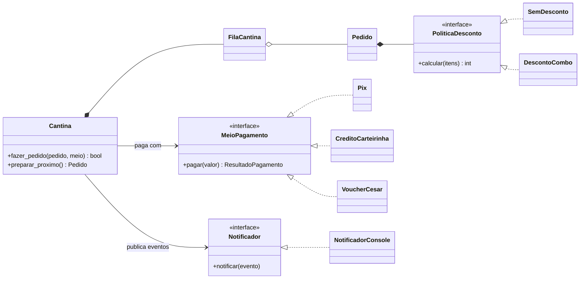

# 🍔 Cantina CESAR · PoC final

> 15 minutos de intervalo, uma fila que não anda e o sonho de um lanche.
> Peça antes, pague, entre na fila e seja avisado quando o pedido estiver pronto.

Hackathon Relâmpago #1 · Fundamentos de Desenvolvimento de Software 2026.2 · CESAR School
Princípios de projeto do cap. 5 de *Engenharia de Software Moderna* (Marco Tulio Valente).

▶️ **[Assistir ao vídeo da Entrega 2](https://brenoferreirasouto-lgtm.github.io/cantina-cesar-poc/video/)** (menos de 3 min, com narração e legenda)

## Equipe

| Papel | O que fez no projeto | Integrante |
|---|---|---|
| Arquitetura e Princípios | Desenhou as abstrações (`MeioPagamento`, `Notificador`, `PoliticaDesconto`) e o mapa de princípios deste README | Breno Ferreira Souto |
| Desenvolvimento do domínio | `Cardapio`, `Pedido`, `FilaCantina`, `Cantina` e o `demo.py` | Vinicius Beleza |
| Qualidade: testes e métricas | Contrato de Liskov, prova do Aberto/Fechado com o voucher e `metricas.py` | Bruno Rodrigues |
| Produto, vídeo e revisão da IA | Escopo do app, roteiro e vídeo, revisão do código gerado (seção "A IA errou") | João Fernando |

## O que o app faz

- **Cardápio do dia**, com combo lanche + bebida a 10% de desconto.
- **Pedido antecipado e pagamento** por Pix ou créditos da carteirinha (e, como extensão, Voucher CESAR).
- **Senha, posição na fila e estimativa** de espera.
- **Aviso de "pedido pronto"**, e quem continua na fila recebe a nova posição.

É uma prova de conceito em Python puro: sem banco de dados, sem deploy e sem dependências, com pagamentos simulados e avisos no terminal.

## Como rodar

Só precisa de Python 3.8 ou mais novo.

```bash
python demo.py                        # um intervalo na cantina
python demo_voucher.py                # novo meio de pagamento (Aberto/Fechado)
python -m unittest -v                 # 19 testes
python metricas.py                    # complexidade ciclomática: go-horse x final
python go_horse/cantina_go_horse.py   # a versão go-horse, para comparar
```

No Mac ou Linux, use `python3` se o comando `python` não existir.

## Estrutura

```
cantina/
  cardapio.py      Produto, Cardapio
  pedido.py        Pedido: itens, valores e estado
  descontos.py     PoliticaDesconto, SemDesconto, DescontoCombo
  pagamento.py     MeioPagamento, Pix, CreditoCarteirinha
  fila.py          FilaCantina
  eventos.py       PedidoPago, PagamentoRecusado, FilaAndou, PedidoPronto
  notificacao.py   Notificador, NotificadorConsole
  cantina.py       Cantina: orquestra pagar → fila → avisar → preparar
  dinheiro.py      valores em centavos e sua formatação
extensoes/
  voucher.py       VoucherCesar (entrou sem editar nada em cantina/)
go_horse/          a versão go-horse, mantida para o antes/depois
testes/            contrato dos meios de pagamento + testes de pedido, fila, cantina e avisos
metricas.py        complexidade ciclomática das duas versões
```



## Onde estão os princípios no código

Cada classe citada também traz o princípio na própria docstring, entre colchetes.

| Princípio | Onde | Por que deixa o projeto melhor |
|---|---|---|
| **Responsabilidade Única e Coesão** | `Cardapio`, `Pedido`, `FilaCantina`, `Cantina`, `NotificadorConsole` | No go-horse, `processar_pedido()` calculava preço, desconto, pagamento, fila e ainda imprimia. Agora cada classe muda por um único motivo: alterar o preço do suco não encosta na fila, e mudar o texto de um aviso não encosta na Cantina. |
| **Ocultamento de informação** | `FilaCantina._pedidos`, `Pedido._itens` e `_status` | No go-horse a fila era uma lista global, e a demo dele mesmo apaga o pedido do Bruno com `fila.pop(1)`. Agora o `deque` é privado e só muda por `entrar()` e `proximo()`. Dá para trocá-lo por outra estrutura sem afetar ninguém. |
| **Acoplamento** | `cantina/eventos.py` | Os eventos levam só dados simples (aluno, senha, valor, posição). O `NotificadorConsole` não conhece `Pedido`, `FilaCantina` nem `Cantina`. |
| **Inversão de Dependências** | `Cantina` | A Cantina depende das abstrações `MeioPagamento` e `Notificador`, não de `Pix` nem de `print()`. É por isso que os testes usam dublês e que o voucher entrou sem mexer nela. |
| **Segregação de Interfaces** | `MeioPagamento.pagar()` e `Notificador.notificar()`, um método cada | `CreditoCarteirinha.recarregar()` existe, mas fica fora da interface. A Cantina não precisa dele, e o voucher não é obrigado a implementá-lo. |
| **Substituição de Liskov** | `testes/contrato_pagamento.py` | Um único conjunto de testes do contrato roda contra todo meio de pagamento, e todos passam. Qualquer meio substitui outro sem a Cantina perceber. |
| **Aberto/Fechado** | `extensoes/voucher.py` | O voucher entrou só com arquivos novos. Prova: `git show --stat prova-aberto-fechado` lista 4 arquivos, todos com apenas inserções. |
| **Composição em vez de herança** | `Pedido` possui uma `PoliticaDesconto` | Em vez de criar `PedidoComDesconto(Pedido)`, troca-se a política (sem desconto, combo 10%, combo 20%) sem nenhuma subclasse de `Pedido`. |
| **Demeter** | `Cantina` | Pede `pedido.total()` e `fila.posicao(pedido)`. Nunca navega por `pedido.itens()[i].preco` nem pelo deque da fila. |
| **Integridade conceitual** | `dinheiro.py` e todo o código | Todo valor é `int` em centavos, formatado num só lugar. O go-horse misturava `float` e imprimia `R$11.25` num lugar e `R$12` em outro. |

## Antes × depois em números

Complexidade ciclomática (seção 5.7 do livro: decisões + 1), calculada pelo `metricas.py` com o módulo `ast`. Os valores batem com os da ferramenta radon.

| | Go-horse | PoC final |
|---|---|---|
| Pior função | `processar_pedido`: **14** | `VoucherCesar.pagar` e `DescontoCombo.calcular`: **3** |
| Funções com CC acima de 10 | 1 | 0 |
| Média por função | 8,5 | 1,4 |

Uma CC de 14 significa ao menos 14 caminhos independentes para testar numa única função. Na versão final, nenhuma função passa de 3.

## A IA errou (e como corrigimos)

O código foi gerado com IA. Na revisão, encontramos dois erros reais. Cada um tem o commit da correção.

**1. A Cantina escrevia os avisos, o que feria a Responsabilidade Única.**
A IA gerou uma `Cantina` que, além de controlar o fluxo, montava as frases para o aluno, com emoji e `R$` formatado:

```python
self._avisar(pedido, f"✅ Pedido #{pedido.senha} pago ({formatar(pedido.total())}). ...")
```

A classe passava a ter dois motivos para mudar: a regra do fluxo e o texto dos avisos. Os testes da Cantina até conferiam frases ("pronto", "1º da fila"). Na correção, a Cantina só publica eventos (`PedidoPago`, `PedidoPronto`...) e o `NotificadorConsole` decide como mostrar. A saída do app ficou idêntica, e mudar um texto não quebra mais os testes da Cantina.
Commit: [`c3caa0d`](https://github.com/brenoferreirasouto-lgtm/cantina-cesar-poc/commit/c3caa0d)

**2. Um toque duplo no "pagar" cobrava duas vezes.**
A IA colocou a cobrança antes da validação. A Cantina debitava o meio de pagamento e só depois o `Pedido` recusava, porque já estava pago. O resultado eram duas cobranças (`[650, 650]`) seguidas de uma exceção. Na correção, `Pedido.validar_para_pagamento()` roda antes de cobrar. A regra continua no `Pedido`, que é quem conhece o próprio estado, e um teste novo cobre o caso.
Commit: [`aa63e90`](https://github.com/brenoferreirasouto-lgtm/cantina-cesar-poc/commit/aa63e90)
